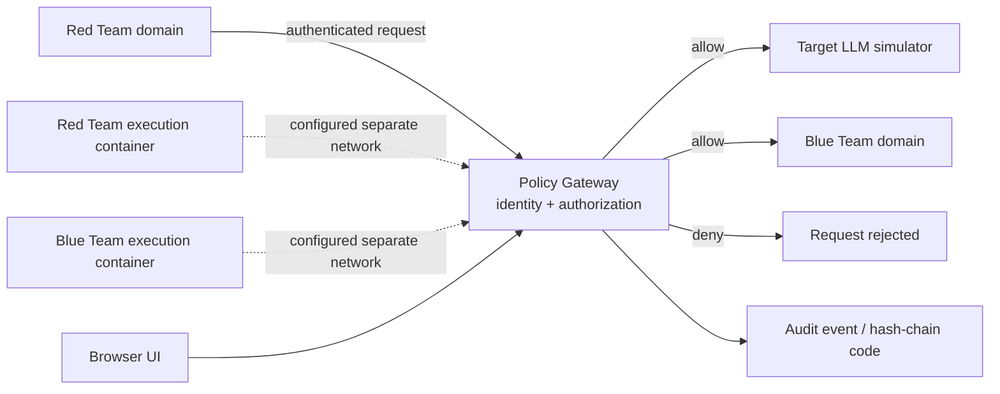

# TrustX Architecture

## Intended request flow

## Trust boundaries

- **Red Team domain:** generates authorized synthetic adversarial requests.
- **Policy gateway:** intended control point for identity checks, policy decisions, routing, and audit events.
- **Target domain:** synthetic target used for controlled testing; do not connect it to real confidential data.
- **Blue Team domain:** defensive workflow/service for the lab.
- **Execution containers:** separate Compose services with resource limits and selected Linux security settings. Their presence/configuration alone does not prove that every escape or cross-network path is blocked.
- **Audit path:** logs and hash-chain verification utilities exist; see `KNOWN_LIMITATIONS.md` for current caveats.

## Design principle

A security decision should be demonstrated end to end: caller identity → policy decision → allow/deny result → observable audit event → test assertion. A UI status or architecture diagram is not, by itself, evidence of enforcement.

## Configuration caveat

The Compose configuration attaches services to named networks and mounts certificate/key paths. Verify the effective network reachability, certificate validation, secret handling, and runtime permissions in the actual running environment before making isolation or mTLS guarantees.
